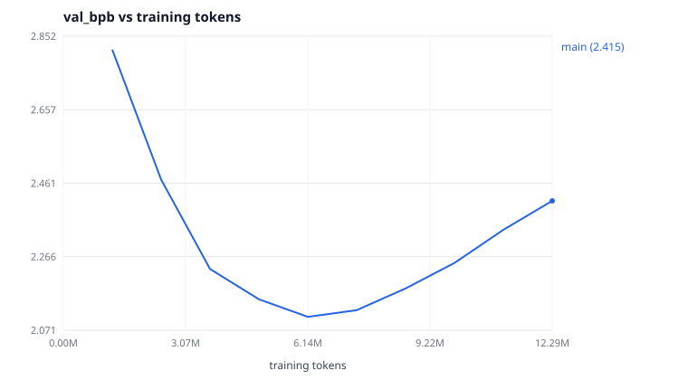
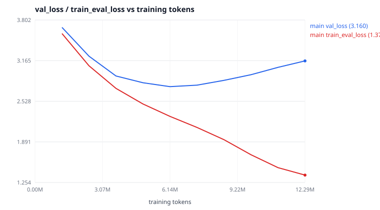

# Evaluation report — `main`, 2026-10-18

Model: 3,344,640-parameter decoder-only Transformer, byte-level BPE-512,
trained from random initialization on the tiny-shakespeare train split.
Checkpoint evaluated: **`best.pt`, step 750, 6,144,000 training tokens**
(the lowest validation loss of the run, not the last weights — see
[§ Overfitting](#overfitting-the-main-finding)).

Protocol: the **test** split, held out from training *and* from the pilot
comparisons and never used to pick a hyperparameter or a checkpoint;
non-overlapping 256-token windows covering 29,696 tokens = 55,349 bytes
(99.3% of the split; the trailing partial window is dropped). Deterministic,
no sampling. Raw numbers: [`eval-test-best.json`](eval-test-best.json),
[`eval-test-last.json`](eval-test-last.json),
[`compressor-baselines.json`](compressor-baselines.json).

## Held-out language modelling

| Model | Loss (nats/token) | Perplexity | **Bits per byte** |
| --- | --- | --- | --- |
| Uniform over the 512-token vocabulary | 6.2383 | 512.00 | 4.8298 |
| This architecture, random init | 6.2812 | 534.43 | 4.8619 |
| Unigram counts (train split, add-0.1) | 5.1753 | 176.84 | 4.0068 |
| Bigram counts (train split, add-0.1) | 3.6466 | 38.34 | 2.8233 |
| **Trained model (`best.pt`, step 750)** | **3.0082** | **20.25** | **2.3284** |
| Trained model (`last.pt`, step 1500) | 3.4475 | 31.42 | 2.6685 |

**Gate 2 passes.** The trained model beats every trivial baseline: 2.07× better
than uniform in bits per byte, 1.72× better than unigram, 1.21× better than the
bigram counter, and 2.09× better than the identical architecture at random
initialization. The random-init row matters most — it is the same code, the
same data pipeline and the same evaluation, with only the training removed, so
it isolates what training contributed from what the setup contributed.

### Against general-purpose compressors

A language model *is* a compressor, so classical compressors are an honest
reference point that needs no machine learning to interpret. Measured on
exactly the same 55,349 bytes:

| Compressor | Standalone | Primed with the train split |
| --- | --- | --- |
| `gzip -9` | 3.3212 | 3.1437 |
| `xz -9` | 3.1365 | 2.5583 |
| `bzip2 -9` | 2.8240 | 2.4638 |
| **This model** | **2.3284** | — |

"Primed" means compressing `train + test` and subtracting the cost of `train`
alone, which is the closest classical analogue to a model that has already read
the training split — otherwise the comparison is unfair in the model's favour.
Even against the primed figures, a 3.3M-parameter model trained for 26 minutes
on two CPU cores encodes held-out Shakespeare in **9% fewer bits than `xz -9`**
and 5.5% fewer than `bzip2 -9`. That is the entire claim: not that the model is
good, but that it demonstrably learned structure in this text.

## Overfitting: the main finding



| Step | Tokens | Epochs | val loss | val bpb | train(eval) loss | gap |
| --- | --- | --- | --- | --- | --- | --- |
| 150 | 1,228,800 | 2.4 | 3.6860 | 2.8164 | 3.5896 | −0.0964 |
| 300 | 2,457,600 | 4.8 | 3.2340 | 2.4710 | 3.0834 | −0.1506 |
| 450 | 3,686,400 | 7.1 | 2.9234 | 2.2337 | 2.7294 | −0.1940 |
| 600 | 4,915,200 | 9.5 | 2.8181 | 2.1532 | 2.4844 | −0.3336 |
| **750** | **6,144,000** | **11.9** | **2.7570** | **2.1066** | 2.2901 | −0.4669 |
| 900 | 7,372,800 | 14.3 | 2.7802 | 2.1243 | 2.1174 | −0.6629 |
| 1050 | 8,601,600 | 16.6 | 2.8558 | 2.1820 | 1.9246 | −0.9311 |
| 1200 | 9,830,400 | 19.0 | 2.9445 | 2.2498 | 1.6889 | −1.2556 |
| 1350 | 11,059,200 | 21.4 | 3.0594 | 2.3377 | 1.4865 | −1.5730 |
| 1500 | 12,288,000 | 23.8 | 3.1602 | 2.4147 | 1.3697 | −1.7905 |



Validation loss bottomed out at **step 750 (11.9 epochs)** and rose for the
remaining half of the run while training loss kept falling — 2.2901 → 1.3697.
This is the textbook signature in `SKILL.md`'s troubleshooting table: *train
loss falls but validation loss worsens ⇒ overfitting, duplication, leakage or
training duration*. Here it is duration against a 1 MB corpus, and it was a
**predicted, accepted risk**: the pilots showed dropout 0.0 was both better at
a short budget and 40% faster on CPU, so the main run took the throughput and
mitigated the risk by evaluating every 150 steps and keeping the best
checkpoint rather than the last.

The mitigation worked, and the cost of *not* having it is measurable: on the
held-out test split, `last.pt` scores 2.6685 bpb against `best.pt`'s 2.3284 —
**14.6% worse**, and barely ahead of the bigram baseline. Half the compute of
this run was spent making the model worse at its actual job.

What a second run should change, in order of expected value: stop at the token
budget where validation flattens (~6M tokens here, so ~12 epochs), or keep the
budget and re-introduce dropout 0.1–0.2 and accept the 40% CPU throughput cost,
or — best — get more data, since 24 epochs over 1 MB is the real problem and no
regularizer fixes a corpus that small.

## Generation

Sampling settings are recorded with every sample in
[`samples.txt`](samples.txt). From `best.pt`, temperature 0.8, top-k 40,
seed 2, prompt `"KING RICHARD III:"`:

```text
KING RICHARD III:
Go with me, good night; I have heard the made;
Must I be giving them to yours:
Look'd for their fathers,
Wherefore, in the night, I musicious precious citizen;
For softed me to the Tame he pass'd with place,
His noble sense, and to be above out:
Nay, those whom I dance to subjects,
And all the end that came to the crown.
```

What is learned: the play format (speaker in caps, colon, newline, verse
lines of roughly the right length), the character inventory, apostrophed
elisions (`Look'd`, `pass'd`), register and common collocations
(`good night`, `to the crown`). What is not: grammatical agreement across a
clause, meaning, and consistency beyond a few lines. Invented words
(`musicious`, `softed`) show the byte-level BPE vocabulary doing what it was
designed to do — compose unseen strings out of subword pieces — without the
model having enough capacity or data to constrain them to real words.

## Leakage, memorization and safety

- **Split leakage:** splits are contiguous in document order with boundaries
  snapped to blank lines, so no context window spans a boundary. The tokenizer
  was fitted on the train split only, so the vocabulary carries no information
  about validation or test text.
- **Test-set hygiene:** every design decision (tokenizer, LR, dropout, tying,
  batch, step count, checkpoint selection) was made on pilots and the
  validation split. The test split was scored twice, after the run, for the
  two rows in the table above.
- **Memorization probe:** 4 samples × 240 tokens at temperature 0.8, top-k 40,
  compared against the training text. Longest verbatim match **27 characters**
  (mean 21.2) for `best.pt`, 24 characters (mean 22.5) for `last.pt`. At this
  length the matches are common phrases, not recall of passages.
- **Privacy:** the corpus audit found zero email addresses, phone numbers,
  IP addresses, URLs or key-like strings, and the text is public domain, so the
  probe calibrates behaviour rather than demonstrating privacy safety. A model
  trained on scraped or user data needs a real extraction evaluation, not this.
- **Safety:** none performed, and none claimed. This is a base model trained
  only to predict the next token of Elizabethan drama; it has no instruction
  tuning, no refusal behaviour, and no content filtering. It should not be
  deployed to users.

## Limitations

1. One 1.1 MB corpus in one domain and one register of English. Nothing here
   generalizes to contemporary text, other languages, or any downstream task.
2. 3.3M parameters and 6.1M training tokens at the selected checkpoint: three
   orders of magnitude below the smallest model anyone would call useful.
3. CPU-only measurements. Throughput, memory and the 185.8 GFLOP/s achieved
   rate describe two Xeon cores and transfer to nothing else.
4. The 2.3284 bpb figure is for this tokenizer on this split. Bits per byte is
   comparable across tokenizers, but not across corpora.
5. Single seed. No error bars; the pilot differences of under ~1% should be
   read as ties, which is why p3 (0.6%) and p7 (0.8%) were decided on
   throughput and prior rather than on the loss difference alone.

## Release decision

**Not released as a model.** The artefact of value is the pipeline and its
evidence trail: the configs, `metrics.jsonl`, this report, the model card and
the tests, all of which reproduce from a clean checkout. The weights
themselves (38 MB of FP32 Adam state) are regenerable in 26 minutes and are
`.gitignore`d rather than committed. Releasing them would imply a usefulness
the measurements above do not support.
