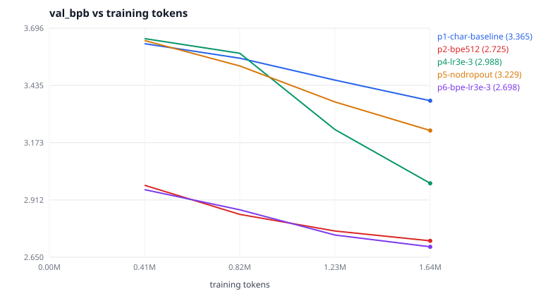

# Pilot matrix — 2026-10-17, tiny-shakespeare on 2 CPU cores

Seven pilots, one variable each, **identical budget of 1,638,400 training
tokens** and seed 1337, run back to back on the same idle 2-vCPU machine.
Raw records: `metrics/p*-metrics.jsonl`. Reproduce all seven with
`bash run_pilots.sh` from `scripts/tiny-gpt` (~35 minutes on two cores).

## Results

| Pilot | Variable changed | Value | Vocab | Params | val loss | **val bpb** | bpb @ equal 230 s | tok/s | Peak RSS | Clipped | Verdict |
| --- | --- | --- | --- | --- | --- | --- | --- | --- | --- | --- | --- |
| p1-char-baseline | — (reference) | char, lr 1e-3, dropout 0.1, tied, 4,096 tok/update | 67 | 3,230,720 | 2.3325 | 3.3651 | 3.4747 | 5,080 | 1,553 MB | 32/400 | baseline |
| p2-bpe512 | tokenizer | byte-level BPE, 512 | 512 | 3,344,640 | 3.5667 | **2.7252** | 2.7833 | 5,022 | 1,553 MB | 22/400 | **adopt** |
| p3-untied | embedding tying | untied | 67 | 3,247,872 | 2.3194 | 3.3462 | 3.4909 | 4,851 | 1,577 MB | 29/400 | reject |
| p4-lr3e-3 | learning rate | 3e-3 | 67 | 3,230,720 | 2.0710 | **2.9878** | 3.2712 | 5,149 | 1,535 MB | 33/400 | **adopt** |
| p5-nodropout | dropout | 0.0 | 67 | 3,230,720 | 2.2382 | 3.2291 | 3.2291 | **7,129** | 1,162 MB | 84/400 | **adopt** |
| p6-bpe-lr3e-3 | all three, at the main-run shape | BPE-512, lr 3e-3, dropout 0, 8,192 tok/update | 512 | 3,344,640 | 3.5308 | **2.6979** | **2.7019** | 6,992 | 1,229 MB | 15/200 | **main run** |
| p7-bpe-lr4.2e-3 | learning rate at 2× batch | 4.2e-3 | 512 | 3,344,640 | 3.5600 | 2.7201 | 2.7201 | 7,172 | 1,255 MB | 15/200 | reject |

`val loss` is per-token negative log-likelihood in nats and is **only
comparable within a tokenizer** — p2's 3.5667 is not worse than p1's 2.3325,
it is a different unit. The bits-per-byte column is the comparable one.
`bpb @ equal 230 s` interpolates each run's validation curve at the wall clock
of the shortest pilot, which is the comparison that matters when the budget is
time rather than tokens.

## What each pilot decided

**p2 — the tokenizer is worth more than any hyperparameter here.** Byte-level
BPE-512 encodes 1.889 bytes per token against the character vocabulary's 1.000,
so at an equal token budget it reads 1.89× more text and its 256-token context
window covers ~484 bytes instead of 256. Result: 2.7252 bpb against 3.3651, a
**19% improvement**, for 1.1% less throughput. Decision: BPE-512 for the main
run. This is also the clearest demonstration of why the plan fixed bits per
byte as the metric before any run started — on per-token loss, the winning
configuration looks 53% *worse*.

**p3 — untying the embeddings is not worth its throughput.** Untied improved
bpb by 0.6% (3.3462 vs 3.3651) and cost 4.5% throughput (4,851 vs 5,080 tok/s).
At equal wall clock the ordering reverses: 3.4909 vs 3.4747 bpb at 230 s. With
a 67-symbol vocabulary the untied output matrix is only 17,152 parameters, so
there was little to gain. Decision: stay tied, and record that the margin is
small enough that it would flip at a larger vocabulary.

**p4 — the learning rate was the biggest single-hyperparameter win.** 3e-3
against 1e-3: 2.9878 vs 3.3651 bpb, **11% better**, with gradient clipping
biting on 33 of 400 steps instead of 32, i.e. no sign of instability. The
default was inherited from nanoGPT's character-level config, which runs 4×
more tokens per update; at 4,096 tokens per update this model could take a
much larger step. Decision: 3e-3.

**p5 — dropout costs 40% of throughput on CPU.** Switching dropout from 0.1 to
0.0 improved bpb by 4% at equal tokens (3.2291 vs 3.3651) and raised throughput
from 5,080 to **7,129 tok/s**, while peak RSS fell from 1,553 MB to 1,162 MB.
Generating and applying dropout masks is cheap next to a GPU's matmuls and
expensive next to two CPU cores'. Clipped steps rose from 32 to 84, which is
the expected noisier-gradient signature, not divergence. Decision: dropout 0.0,
with the overfitting risk handled by evaluating every 150 steps and keeping
`best.pt` rather than the final weights — the main run is ~24 epochs over a
1 MB corpus, well past where this corpus usually starts to be memorized.

**p6 — confirm the combination, not just the parts.** Three pilots each won
alone; that does not prove they win together, and p6 also doubles tokens per
update to the main run's 8,192. It reached 2.6979 bpb, better than p2's 2.7252
at the same token budget while running 39% faster. Decision: this is the main
configuration.

**p7 — the √batch learning-rate rule did not pay here.** `references/training-defaults.md`
records nanochat's `η ∝ √(B/B_ref)`, which at 2× batch suggests 3e-3 × √2 ≈
4.2e-3. Measured: 2.7201 vs p6's 2.6979, i.e. 0.8% **worse**. The rule is a
prior, not a law, and 1.6M tokens is a short horizon to judge it on; recorded
as "tested, not adopted" rather than quietly dropped.

## Gate for advancing to the main run

| Criterion | Threshold | Measured | Pass |
| --- | --- | --- | --- |
| Throughput sufficient for the 30-minute ceiling | ≥ 5,000 tok/s | 6,992 tok/s | yes |
| Peak memory inside 3 GB | < 2,500 MB | 1,229 MB | yes |
| Validation loss falling monotonically | no upturn in 4 evals | monotone | yes |
| Stability | no non-finite steps, clipping not pervasive | 0 non-finite, 15/200 clipped | yes |
| Beats the previous best configuration | lower bpb at equal tokens | 2.6979 < 2.7252 | yes |

## Pilot measurement (the numbers the main-run estimate is built on)

- **Hardware/software:** 2 vCPU Intel Xeon @ 2.60 GHz, 3 GB RAM, no GPU;
  Linux 6.1.158, Python 3.11.2, torch 2.14.1+cu130 running on CPU, numpy 2.4.6,
  `torch.set_num_threads(2)`. Note the `+cu130` build tag: it is the default
  PyPI wheel, and it is *not* using CUDA (`torch.cuda.is_available()` is False).
- **Warm-up excluded?** No `torch.compile`, so there is no compilation step to
  exclude; step 1 is slower than steady state by about 25% and is included in
  the mean, which makes the reported tok/s mildly conservative.
- **Sustained throughput:** 6,992 tok/s at the chosen configuration
  (7,172 observed for p7 on the same shape, so read this as ~7,000 ± 3%; the
  sandbox is shared and the variance between identical shapes is about that).
- **Peak memory:** 1,229 MB resident, 41% of the machine's 3 GB.
- **Validation trend:** 2.9590 → 2.8670 → 2.7516 → 2.6979 bpb over the four
  evals of p6; still falling at the end of the pilot, which is why the main run
  extends the budget rather than the model.
- **Checkpoint size and duration:** 38.4 MB for `last.pt` (FP32 weights plus
  two AdamW moments), written atomically in ~0.4 s.
- **Estimate for the main run:** 1,500 steps × 8,192 = 12,288,000 tokens at
  ~7,000 tok/s = **1,756 s of compute**, plus 10 validation passes and 3 sample
  generations ≈ 150 s, so **≈ 32 minutes ± 10%**. Cost: $0, this is local CPU
  time. Reality check after the fact is in the run manifest.
