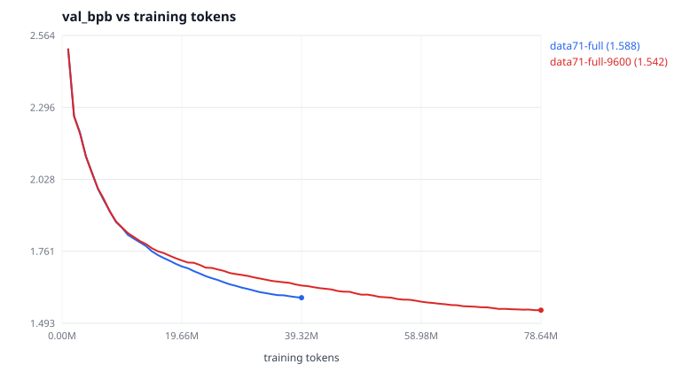

# Does more data help? Asked properly this time

[`data-scaling-and-seed-bar.md`](data-scaling-and-seed-bar.md) measured 3.53×
more training text and found it **worse** — +0.53% test bits per byte. That
experiment held the evaluation fixed on the original 27 books, which is what
made it a controlled comparison and also what made it unable to answer the
general question: an evaluation that never looks at the added material cannot
report that the model learned it.

This asks the question with the evaluation covering everything.

Regenerate every number below with:

```bash
python experiments/2026-10-18-gutenberg-mixed/analyze-clean-data.py
```

which writes `clean-data-summary.json`. The prose is checked against that file
by `.github/scripts/check_docs_math.py`.

---

## Setup

Two corpora, 71 documents each, identical corpus hash. They differ in one
thing: which documents feed the training split.

| | `gutenberg-mixed-71-full` | `gutenberg-mixed-71-ctrl` |
| --- | --- | --- |
| documents | 71 | 71 |
| train on | all 71 | the original 27 |
| train tokens | **18,939,699** | **5,771,560** |
| epochs at 39.3M tokens | 2.08 | 6.81 |
| val tokens | 1,042,315 | 1,042,315 |
| test tokens | 1,038,419 | 1,038,419 |

The 44 additions are marked `eval_only` in the control: split in the usual
proportions, their val and test pieces kept, their training piece dropped. The
control is prepared with `--tokenizer-from` pointed at the full arm, so both
share one vocabulary. Verified before training started:

* `val.bin`, `test.bin` and `tokenizer.json` are **byte-identical** between the
  two prepared corpora (`cmp`).
* The control's `train.bin` and `tokenizer.json` are **byte-identical** to a
  fresh preparation of `gutenberg-mixed-27` — so the control arm is a bit-exact
  re-run of the released configuration, on different evaluation splits.

Both runs: 4,800 steps × 8,192 tokens, seed 1337, identical schedule, identical
40-point evaluation grid. The only difference in the two config files is
`run_id` and `data_dir`.

One setting is new. `eval_spread: true` makes the capped in-training evaluation
slice take evenly spaced windows instead of a prefix. Without it, 98,304 of
1,042,315 val tokens would have covered the first 8 of 71 books — see the
correction in the previous report. Test-split figures never used the cap and
are unaffected.

---

## Result

| arm | train tokens | epochs | val bpb | test bpb | gap | clipped | longest verbatim |
| --- | ---: | ---: | ---: | ---: | ---: | ---: | ---: |
| **full** (71 books) | 18,939,699 | 2.08 | **1.5883** | **1.6147** | −0.0686 | 34 | 31 |
| control (27 books) | 5,771,560 | 6.81 | 1.7161 | 1.7418 | −0.3930 | 63 | 25 |
| Δ | 3.28× | | **−7.45%** | **−7.30%** | | | |

**More data helps, by 7.30% of test bits per byte** — 19.8× the measured seed
bar. The full arm leads from **step 120** and at all **40** common evaluation
points; the margin is flat across the last five evaluations (−7.16%, −7.09%,
−7.27%, −7.18%, −7.45%), so this is not a transient.


This is the largest effect any lever has produced in this project, by a wide
margin. The next largest was doubling the step count, at 3.67%.

---

## The decomposition: both results inside one pair of runs

The test split is the per-document test pieces concatenated in document order,
and EOS is only ever emitted as the separator between them, so it cuts cleanly
into the part both arms trained on and the part only one arm trained on.

| | tokens | full | control | Δ |
| --- | ---: | ---: | ---: | ---: |
| the original 27 books | 323,284 | 1.6645 | 1.6586 | **+0.35%** |
| the added 44 books | 715,134 | 1.5926 | 1.7788 | **−10.47%** |

The left column is the previous experiment, reproduced: training on the extra
books costs **+0.35%** on the original 27-book test split, against the +0.53%
measured there. Both numbers are at or inside the 0.37% seed bar, so the honest
reading of *both* experiments is that the cost on the original distribution is
**not distinguishable from noise**.

The right column is what that experiment could not see: on the material it
added, the same model is **10.47% better**.

So the earlier negative result was real but narrow, and it was a statement
about the evaluation rather than about the data. Corrected:

> At fixed compute, training on 3.28× more text costs nothing measurable on the
> original distribution and buys 10.47% on the rest of it.

The `original27` slice used here is byte-identical to the standalone 27-book
`test.bin`, so that +0.35% is measured on exactly the bytes every earlier
report used.

---

## Capacity, re-asked — the obvious follow-up, and it fails

The size sweep found 3.74M parameters a tie with 1.77M (+0.22% test bits per
byte, inside the seed bar) and 5.64M clearly worse. That was measured on the
27-book corpus at 6.81 epochs, where the model re-read the same text seven
times. "Capacity does not help" and "capacity does not help *on this much
data*" are different claims, and only the second was tested — so with the
corpus 3.28× larger and the budget down to 2.08 epochs, the tie ought to break.

It does not. Same method as the size sweep: wall-clock matching, because the
question is what a fixed compute budget buys.

| run | params | steps | tokens | elapsed | val bpb | test bpb |
| --- | ---: | ---: | ---: | ---: | ---: | ---: |
| `data71-full` | 1,770,816 | 4,800 | 39,321,600 | 3,130 s | **1.5883** | **1.6147** |
| `size-4L256d-gb71` | 3,737,856 | 2,571 | 21,061,632 | 3,110 s | 1.6103 | 1.6365 |

Wall clock matched to **−0.6%**. At 2.11× the parameters the larger model is
**+1.35%** worse — against +0.22% on the 27-book corpus. The tie did not break;
it widened to 3.7× the seed bar, and the direction is the opposite of the
hypothesis.

The reading: more data does not make parameters more valuable here, it makes
*steps* more valuable. At 6.81 epochs a step is largely re-reading and is worth
less; at 2.08 epochs most of what a step sees is new. The larger model buys its
capacity by giving up 46% of its steps, and that trade got worse, not better,
when the steps got more informative.

So the binding constraint at this budget is optimization steps, which is
consistent with the only other lever that ever paid being the step count
itself. Growing the model is something to do after the compute, not instead
of it.

## Horizon — spending the compute the capacity test said to spend

The capacity result says the binding constraint is optimization steps, not
parameters. The direct test of that is to leave the model alone and double the
horizon. `data71-full-9600` is `data71-full` with two lines changed:
`max_steps: 9600` and a larger wall-clock guard.

| run | steps | tokens | epochs | s | val | test |
| --- | ---: | ---: | ---: | ---: | ---: | ---: |
| `data71-full` | 4,800 | 39,321,600 | 2.08 | 3,130 | 1.5883 | 1.6147 |
| `data71-full-9600` | 9,600 | 78,643,200 | 4.15 | 6,131 | 1.5417 | **1.5662** |



The two curves are nearly superimposed where they overlap, and that is a
schedule artifact rather than a result — read the endpoints, not the overlap.

**Doubling the horizon bought 3.00% of test bits per byte** (0.0484 absolute),
or 8.1× the seed bar. Unlike the capacity test this is *not* clock-matched —
it is twice the compute for 3.00%, and it should be read as "what does another
hour buy", not "is this the better way to spend the hour".

Three things are worth pulling out of it.

**The return is falling, but slowly.** The previous doubling, 2,400 → 4,800,
bought 3.67%; this one bought 3.00%. The sharper version of the same signal is
inside each run: over its final four evaluations the 4,800-step run was still
improving at 0.0097 bpb, the 9,600-step run at 0.0031 bpb — 3.2× flatter. Both
numbers are measured on the same 120-step eval grid, so they are comparable
even though the runs are not comparable mid-flight.

**The run still has not converged.** `best.pt` is step 9,600 — the argmin of
the validation curve is its last point. Every run in this project has ended
while still improving, which is why "train longer" keeps working and why the
checkpoint-selection floor found [below](#a-reproducibility-floor-found-by-accident)
does not bite here.

**Mid-run comparison between the two is meaningless.** They share a warmup and
an eval grid, so the curves are identical up to step 240 and then diverge —
but the divergence is mostly the cosine schedule, not learning. At any step
before the end the longer run is mid-anneal at a higher learning rate and is
penalised roughly 0.035 bpb for it. Only the endpoints compare cleanly, which
is why the table has two rows and not forty.

### Where the extra compute landed

Running the same EOS decomposition on the longer model:

| slice | released (27-book model) | `data71-full` | `data71-full-9600` |
| --- | ---: | ---: | ---: |
| original 27 | 1.6569 | 1.6645 | **1.6139** |
| added 44 | — | 1.5926 | **1.5451** |

This is the number that changes the release decision. On the *exact bytes the
released model is scored on*, the longer run is **2.60% better** — 7.0× the
seed bar. The earlier full-data model was tied there (+0.35%, inside the bar),
so continuity cost nothing to keep. It is no longer free: the 71-book model is
now better on the old benchmark as well as the new one.

### The spread between books dwarfs every lever

The new `--per-document` evaluation scores all 71 test documents separately:

| | book | bpb |
| --- | --- | ---: |
| easiest | Pride and Prejudice | 1.3511 |
| hardest | On the Origin of Species | 2.1509 |

Mean 1.5798, sd 0.1612, range 0.7998 — **50.6% of the mean**. Every lever this
project has measured moves the aggregate by less than 8%; *which books are in
the test set* moves it by 50%. An aggregate bits-per-byte number is a weighted
average over a corpus mixture, and comparing two such numbers is only
meaningful when the mixture is held byte-for-byte identical. That is the same
lesson the decomposition taught, stated as a property of the corpus rather
than of one experiment, and it is now a flag on the evaluator so the next
experiment gets it for free.

## Two things in the table that are not what they look like

**The gap changed sign, and it is not measuring overfitting.** `gap` is
`train_eval_loss − val_loss`. Every earlier run in this directory reported a
*positive* gap — held-out training slices scored *worse* than validation —
which was already odd. Both readings now have the same explanation, and it is
distribution match, not memorization:

* Earlier runs validated on the first 8 of the 27 books (Austen, the Brontës,
  Shelley, Stoker, Melville). That slice is *easier* than the training mix, so
  val beat train and the gap came out positive.
* The control arm trains on 27 books and validates on 71, so it finds its
  training distribution much easier than its validation set: **−0.3930**.
* The full arm trains and validates on the same 71 books, and its gap nearly
  vanishes: **−0.0686**.

A gap near zero is the signature of train and validation being the same
distribution. That is a useful diagnostic and it is not an overfitting number.

**The verbatim match (25 → 31 characters) is not more memorization.** The probe
searches generated text against the run's own training split, and the full
arm's is 3.28× larger, so a longer coincidental match is more likely. The
number tracks corpus size at least as much as model behaviour.

---

## A reproducibility floor, found by accident

The control arm trains on byte-identical data to `main-gutenberg-4800` with the
same seed and the same configuration. It should be the same model. On the same
test bytes it scores **1.6586** against the released run's **1.6569** —
**+0.103%**.

The cause is not floating-point drift. It is checkpoint selection: `best.pt` is
whichever evaluation step had the lowest validation loss, and the two runs
ranked the steps differently because they used different validation slices.
`main-gutenberg-4800` picked step 4,800; the control picked step **4,680**. In
a run whose loss is still falling, picking anything but the last step costs a
little.

So "best checkpoint" selection on a noisy validation metric is worth about
0.1% here — a quarter of the seed bar, and a floor underneath it that no amount
of seed averaging removes. On a run that has not converged, the final
checkpoint is the better default.

---

## What this means for the released model

The argument for keeping `main-gutenberg-4800` was that the 71-book model only
*tied* with it on the 27-book test split:

* On the 27-book test split the two are **tied** (+0.35%, inside the seed bar).
* On the 71-book test split the full-data model is **7.30% better**.
* They cost the same to train.

A tie made continuity free, so continuity won. The horizon run ends that: at
9,600 steps the 71-book model scores **1.6139** on the 27-book test bytes
against the released model's **1.6569**, which is 2.60% better and 7.0× the
seed bar. There is no longer a slice of the evaluation on which the old
release is competitive.

**`data71-full-9600` is therefore the released model as of 2026-10-20**, with
its own card at [`model-card-71.md`](model-card-71.md).
[`model-card.md`](model-card.md) stays in place, marked superseded, as the
record of the numbers published before it. Nothing historical is restated:
every earlier number keeps meaning what it meant, which is exactly why the
comparison above had to be run on the old bytes rather than the new ones.

## Where the project stands

| lever | tested range | effect at full budget |
| --- | --- | --- |
| **training data** | 5.77M → 18.9M tokens | **−7.30%** on matching evaluation; tie on the old one |
| **training steps** | 2,400 → 4,800 → 9,600 | **−3.67%**, then **−3.00%** |
| *corpus mixture* | *which 71 books* | *50.6% spread between easiest and hardest* |

Batch size has since been tested too, on the same corpus and at a fixed
token budget, and is reported separately in [`batch-size.md`](batch-size.md):
flat below 8,192 tokens per update once the learning rate is rescaled, and
harmful above it.
| model size | 1.77M → 5.64M params | tie on 27 books, **+1.35% worse** on 71 |
| context length | 128 → 1024 | worse in both directions |
| peak learning rate | 1.5e-3 → 6e-3 | tie above, worse below |
| seed | 1337–1339 | 0.37% noise floor |
| checkpoint selection | best vs final | 0.10% |

Data is now the only lever that has produced a large win, and it was hiding
behind an evaluation that could not see it. The corpus is the thing to grow
next, and the evaluation has to grow with it.

The capacity result above sharpens that: with more data the right move is
*more steps on the small model*, not a bigger model on the same budget. Two
levers therefore point the same way — at this scale the project is
compute-limited, and the compute should be spent reading more text rather than
on more parameters.

The horizon run then confirms it by prediction rather than by hindsight: the
capacity test said steps were the binding constraint, the obvious consequence
was that doubling steps should pay, and it paid 3.00%. The marginal return is
falling (3.67% → 3.00%, and 3.2× flatter inside the run), so the next doubling
is worth perhaps 2% and the one after that less. That is the point at which
*more books* overtakes *more passes over the same books*, which is where the
last row of the table is pointing: 50.6% of spread between documents is a much
larger pool of available signal than anything left on the step axis.

## Artifacts

| file | what |
| --- | --- |
| `metrics/data71-{full,ctrl}.jsonl`, `-summary.json` | raw per-step metrics and run-end summaries |
| `eval-test-data71-{full,ctrl}.json` | held-out test evaluations, full 1,038,419-token split |
| `config-data71-{full,ctrl}.yaml` | exact configs; they differ in two lines |
| `data-manifest-71-{full,ctrl}.json` | per-document provenance and split hashes for both arms |
| `clean-data-summary.json` | every number in this document |
| `clean-data-scaling.svg` | the two validation curves |
| `horizon.svg` | the 4,800- and 9,600-step validation curves |
| `metrics/size-4L256d-gb71.jsonl`, `-summary.json`, `eval-test-size-4L256d-gb71.json`, `config-size-4L256d-gb71.yaml` | the capacity re-test |
| `metrics/data71-full-9600.jsonl`, `-summary.json`, `config-data71-full-9600.yaml` | the horizon run |
| `eval-test-data71-full-9600.json` | its test evaluation, including the 71 per-document scores |
| `model-card-71.md` | card for the model this run released |
| `analyze-clean-data.py` | the analysis, including the decomposition and the capacity re-test |
