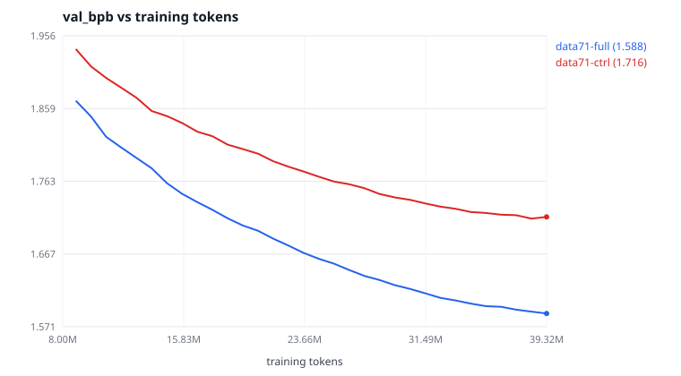

# Does more data help? Asked properly this time

[`data-scaling-and-seed-bar.md`](data-scaling-and-seed-bar.md) measured 3.53×
more training text and found it **worse** — +0.53% test bits per byte. That
experiment held the evaluation fixed on the original 27 books, which is what
made it a controlled comparison and also what made it unable to answer the
general question: an evaluation that never looks at the added material cannot
report that the model learned it.

This asks the question with the evaluation covering everything.

Regenerate every number below with:

```bash
python experiments/2026-10-18-gutenberg-mixed/analyze-clean-data.py
```

which writes `clean-data-summary.json`. The prose is checked against that file
by `.github/scripts/check_docs_math.py`.

---

## Setup

Two corpora, 71 documents each, identical corpus hash. They differ in one
thing: which documents feed the training split.

| | `gutenberg-mixed-71-full` | `gutenberg-mixed-71-ctrl` |
| --- | --- | --- |
| documents | 71 | 71 |
| train on | all 71 | the original 27 |
| train tokens | **18,939,699** | **5,771,560** |
| epochs at 39.3M tokens | 2.08 | 6.81 |
| val tokens | 1,042,315 | 1,042,315 |
| test tokens | 1,038,419 | 1,038,419 |

The 44 additions are marked `eval_only` in the control: split in the usual
proportions, their val and test pieces kept, their training piece dropped. The
control is prepared with `--tokenizer-from` pointed at the full arm, so both
share one vocabulary. Verified before training started:

* `val.bin`, `test.bin` and `tokenizer.json` are **byte-identical** between the
  two prepared corpora (`cmp`).
* The control's `train.bin` and `tokenizer.json` are **byte-identical** to a
  fresh preparation of `gutenberg-mixed-27` — so the control arm is a bit-exact
  re-run of the released configuration, on different evaluation splits.

Both runs: 4,800 steps × 8,192 tokens, seed 1337, identical schedule, identical
40-point evaluation grid. The only difference in the two config files is
`run_id` and `data_dir`.

One setting is new. `eval_spread: true` makes the capped in-training evaluation
slice take evenly spaced windows instead of a prefix. Without it, 98,304 of
1,042,315 val tokens would have covered the first 8 of 71 books — see the
correction in the previous report. Test-split figures never used the cap and
are unaffected.

---

## Result

| arm | train tokens | epochs | val bpb | test bpb | gap | clipped | longest verbatim |
| --- | ---: | ---: | ---: | ---: | ---: | ---: | ---: |
| **full** (71 books) | 18,939,699 | 2.08 | **1.5883** | **1.6147** | −0.0686 | 34 | 31 |
| control (27 books) | 5,771,560 | 6.81 | 1.7161 | 1.7418 | −0.3930 | 63 | 25 |
| Δ | 3.28× | | **−7.45%** | **−7.30%** | | | |

**More data helps, by 7.30% of test bits per byte** — 19.8× the measured seed
bar. The full arm leads from **step 120** and at all **40** common evaluation
points; the margin is flat across the last five evaluations (−7.16%, −7.09%,
−7.27%, −7.18%, −7.45%), so this is not a transient.



This is the largest effect any lever has produced in this project, by a wide
margin. The next largest was doubling the step count, at 3.67%.

---

## The decomposition: both results inside one pair of runs

The test split is the per-document test pieces concatenated in document order,
and EOS is only ever emitted as the separator between them, so it cuts cleanly
into the part both arms trained on and the part only one arm trained on.

| | tokens | full | control | Δ |
| --- | ---: | ---: | ---: | ---: |
| the original 27 books | 323,284 | 1.6645 | 1.6586 | **+0.35%** |
| the added 44 books | 715,134 | 1.5926 | 1.7788 | **−10.47%** |

The left column is the previous experiment, reproduced: training on the extra
books costs **+0.35%** on the original 27-book test split, against the +0.53%
measured there. Both numbers are at or inside the 0.37% seed bar, so the honest
reading of *both* experiments is that the cost on the original distribution is
**not distinguishable from noise**.

The right column is what that experiment could not see: on the material it
added, the same model is **10.47% better**.

So the earlier negative result was real but narrow, and it was a statement
about the evaluation rather than about the data. Corrected:

> At fixed compute, training on 3.28× more text costs nothing measurable on the
> original distribution and buys 10.47% on the rest of it.

The `original27` slice used here is byte-identical to the standalone 27-book
`test.bin`, so that +0.35% is measured on exactly the bytes every earlier
report used.

---

## Two things in the table that are not what they look like

**The gap changed sign, and it is not measuring overfitting.** `gap` is
`train_eval_loss − val_loss`. Every earlier run in this directory reported a
*positive* gap — held-out training slices scored *worse* than validation —
which was already odd. Both readings now have the same explanation, and it is
distribution match, not memorization:

* Earlier runs validated on the first 8 of the 27 books (Austen, the Brontës,
  Shelley, Stoker, Melville). That slice is *easier* than the training mix, so
  val beat train and the gap came out positive.
* The control arm trains on 27 books and validates on 71, so it finds its
  training distribution much easier than its validation set: **−0.3930**.
* The full arm trains and validates on the same 71 books, and its gap nearly
  vanishes: **−0.0686**.

A gap near zero is the signature of train and validation being the same
distribution. That is a useful diagnostic and it is not an overfitting number.

**The verbatim match (25 → 31 characters) is not more memorization.** The probe
searches generated text against the run's own training split, and the full
arm's is 3.28× larger, so a longer coincidental match is more likely. The
number tracks corpus size at least as much as model behaviour.

---

## A reproducibility floor, found by accident

The control arm trains on byte-identical data to `main-gutenberg-4800` with the
same seed and the same configuration. It should be the same model. On the same
test bytes it scores **1.6586** against the released run's **1.6569** —
**+0.103%**.

The cause is not floating-point drift. It is checkpoint selection: `best.pt` is
whichever evaluation step had the lowest validation loss, and the two runs
ranked the steps differently because they used different validation slices.
`main-gutenberg-4800` picked step 4,800; the control picked step **4,680**. In
a run whose loss is still falling, picking anything but the last step costs a
little.

So "best checkpoint" selection on a noisy validation metric is worth about
0.1% here — a quarter of the seed bar, and a floor underneath it that no amount
of seed averaging removes. On a run that has not converged, the final
checkpoint is the better default.

---

## What this means for the released model

`main-gutenberg-4800` stays the released model, because every published number
in this directory is measured against the 27-book test split and continuity is
worth more than 0.35%. But the honest summary is:

* On the 27-book test split the two are **tied** (+0.35%, inside the seed bar).
* On the 71-book test split the full-data model is **7.30% better**.
* They cost the same to train.

A model trained on all 71 books is the better artifact. It is not released only
because releasing it would silently change what every historical number means.

## Where the project stands

| lever | tested range | effect at full budget |
| --- | --- | --- |
| **training data** | 5.77M → 18.9M tokens | **−7.30%** on matching evaluation; tie on the old one |
| training steps | 2,400 → 4,800 | −3.67% |
| model size | 1.77M → 5.64M params | tie, then worse |
| context length | 128 → 1024 | worse in both directions |
| peak learning rate | 1.5e-3 → 6e-3 | tie above, worse below |
| seed | 1337–1339 | 0.37% noise floor |
| checkpoint selection | best vs final | 0.10% |

Data is now the only lever that has produced a large win, and it was hiding
behind an evaluation that could not see it. The corpus is the thing to grow
next, and the evaluation has to grow with it.

## Artifacts

| file | what |
| --- | --- |
| `metrics/data71-{full,ctrl}.jsonl`, `-summary.json` | raw per-step metrics and run-end summaries |
| `eval-test-data71-{full,ctrl}.json` | held-out test evaluations, full 1,038,419-token split |
| `config-data71-{full,ctrl}.yaml` | exact configs; they differ in two lines |
| `data-manifest-71-{full,ctrl}.json` | per-document provenance and split hashes for both arms |
| `clean-data-summary.json` | every number in this document |
| `clean-data-scaling.svg` | the two validation curves |
| `analyze-clean-data.py` | the analysis, including the decomposition |
