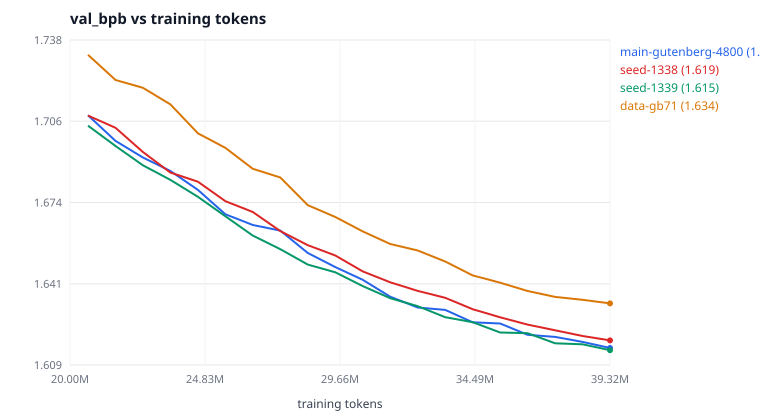

# Seed bar, and 3.53× the data

Two experiments reported together, because the first one is what makes the
second one readable.

Every margin reported in this directory so far — the size sweep, the context
sweep, the learning-rate bracket — was a single run against a single run. None
of them had an error bar. This note measures the error bar, then spends it on
the one lever that had not been tested: **more data**.

Regenerate every number below with:

```bash
python experiments/2026-10-18-gutenberg-mixed/analyze-data-seed.py
```

which reads the raw `metrics/*.jsonl`, `eval-test-*.json` and
`distribution-shift.json` artifacts and writes `data-seed-summary.json`. The
prose here is checked against that file by `.github/scripts/check_docs_math.py`.

---

## 1. The seed bar

Three runs of the released configuration — `main-gutenberg-4800` — changing
nothing but `seed`. Same 27-book corpus, same 4,800 steps × 8,192 tokens,
same cosine schedule, same 40-point evaluation grid.

| seed | val bpb | test bpb | gap | clipped steps | longest verbatim | elapsed |
| --- | ---: | ---: | ---: | ---: | ---: | ---: |
| 1337 (released) | 1.6158 | 1.6569 | +0.0399 | 63 | 24 | 2,926 s |
| 1338 | 1.6188 | 1.6592 | +0.0365 | 40 | 25 | 2,916 s |
| 1339 | 1.6149 | 1.6531 | +0.0244 | 76 | 23 | 2,963 s |

|  | mean | min | max | range | sd |
| --- | ---: | ---: | ---: | ---: | ---: |
| val bpb | 1.6165 | 1.6149 | 1.6188 | 0.0039 (**0.24%**) | 0.0020 (0.13%) |
| test bpb | 1.6564 | 1.6531 | 1.6592 | 0.0061 (**0.37%**) | 0.0031 (0.19%) |

**Run-to-run noise on the test split is 0.37% peak-to-peak.** That is the
resolution of every experiment in this directory. It is not small: it is larger
than two of the seven margins previously reported.

Note also that the released seed, 1337, is not the best of the three — 1339
beats it on both splits. The released checkpoint was never selected for being
lucky; it was simply the first one run. Had the seeds been searched over, the
headline number could have been quoted as 1.6531 with no change to the method,
which is a good illustration of why a seed bar belongs next to any tuning
result.

### What the bar does to the earlier claims

| experiment | margin vs reference (test bpb) | verdict at a 0.37% bar |
| --- | ---: | --- |
| size 3.74M params | +0.22% | **inside the bar — not distinguishable** |
| size 5.64M params | +2.11% | outside — real |
| context T=128 | +0.64% | outside — real, but only 1.7× the bar |
| context T=512 | +1.56% | outside — real |
| context T=1024 | +10.30% | outside — real, and large |
| peak LR 1.5e-3 | +0.83% | outside — real |
| peak LR 6.0e-3 | +0.08% | **inside the bar — not distinguishable** |

Both of the margins that were *called* ties in the earlier write-ups — the
3.74M-parameter model and the 6e-3 learning rate — are confirmed as ties, and
for the right reason. Two claims should be softened:

* **T=128 is only 1.7× the bar.** The context sweep's conclusion that 256 is an
  interior optimum rests on the T=512 and T=1024 arms, which are far outside the
  bar. The claim that 256 beats 128 is real but thin, and the sweep's own
  explanation for it — throughput, not modelling — is the right one.
* **The "3e-3 sits on the left edge of a plateau" reading is now better
  supported, not worse.** 6e-3 is a tie, 1.5e-3 is 2.3× the bar away. The
  plateau is between 3e-3 and 6e-3 and the left wall is real.

---

## 2. Data scaling: 3.53× more text, at fixed compute

### The corpus

`gutenberg-mixed-71` = the original 27 books plus **44** more resolved from
GITenberg, all public-domain. The 44 additions carry `train_only=True`: they
contribute to the training split and to nothing else.

| | 27 books | 71 books |
| --- | ---: | ---: |
| documents | 27 | 71 |
| characters | 18,777,471 | 60,467,324 |
| train tokens | 5,771,560 | **20,379,728** (3.53×) |
| val tokens | 317,418 | 317,418 |
| test tokens | 323,284 | 323,284 |
| epochs over train at 39.3M tokens | 6.81 | 1.93 |

`val.bin`, `test.bin` and `tokenizer.json` are **byte-identical** between the
two prepared corpora (verified with `cmp`); only `train.bin` differs. That
equality is the whole point of the experiment and it was not free — see
*Two traps* below.

### Result

Both runs: 4,800 steps, 8,192 tokens/step, seed 1337, identical schedule,
identical 40-point grid. The only difference is `data_dir`.

| | train tokens | epochs | val bpb | test bpb | gap | clipped | longest verbatim |
| --- | ---: | ---: | ---: | ---: | ---: | ---: | ---: |
| 27 books | 5,771,560 | 6.81 | **1.6158** | **1.6569** | +0.0399 | 63 | 24 |
| 71 books | 20,379,728 | 1.93 | 1.6335 | 1.6658 | +0.1522 | 38 | 29 |
| Δ | 3.53× | | **+1.10%** | **+0.53%** | | | |

**More data made the model worse.** +0.53% on test is 1.4× the seed range and
+3.0 seed standard deviations; +1.10% on val is +8.3 seed standard deviations.
With only three seeds those are suggestive rather than a p-value, but the sign
is not in doubt: the 27-book run takes the lead at **step 120** and never gives
it back across all **40** common evaluation points, and the deficit is still
≈1% at the end of the cosine.



The widening-then-stable tail (+1.15%, +1.00%, +1.07%, +0.98%, +1.03%, +1.10%
over the last six evaluations) says this is not a transient that another few
hundred steps would close.

Two things in the table are *not* evidence of anything and should not be read
as such:

* **The gap (+0.0399 → +0.1522) is not comparable between the two runs.** `gap`
  is `train_eval_loss − val_loss`, and the train-eval slices are drawn from each
  run's own training split. The 71-book run's training split contains Ulysses,
  Dante and the Iliad; it is simply harder text. The gap grew because the
  training distribution got harder, not because the model overfit more. (In both
  runs the gap is *positive*, i.e. held-out train slices score worse than val —
  there is no measurable memorization signal in either.)
* **The longest verbatim match (24 → 29 chars) is not a memorization increase.**
  The probe searches for the generated sample inside the training split, and
  that split is 3.53× bigger, so a longer coincidental match is more likely. The
  number is a function of corpus size as much as of the model.

---

## 3. Why: the additions are a different distribution

A negative result is only useful if you know which of the two obvious
explanations it supports:

1. a 1.77M-parameter model is **capacity-limited, not data-limited**, so extra
   text cannot help; or
2. the extra text is **a different distribution** from val/test, so it competes
   for capacity with the material being scored.

These are separable without training anything. A model trained on the 27 books
has never seen the 44 additions, so its bits per byte on a sample of them is a
clean out-of-distribution reading — same model, same tokenizer, same units as
its test score. `distribution-shift-probe.py` takes a 24,000-character slice
from the middle of each of the 44 additions (**365,371** tokens, comparable to
the 323,284-token test split) and scores it.

| model | saw the 44 books? | test, 27 books | probe, 44 books | shift |
| --- | --- | ---: | ---: | ---: |
| seed-1338 | no — held out | 1.6592 | 1.7736 | +6.90% |
| seed-1339 | no — held out | 1.6531 | 1.7684 | +6.97% |
| data-gb71 | **yes — trained on** | 1.6658 | 1.5977 | −4.08% |

**A clean 27-book model finds the additions 6.93% harder than its own test
split** — nearly 19× the seed bar. The 44 books are not "more of the same".
They are measurably further from the evaluation distribution than the
evaluation distribution is from itself.

And the trade is extremely lopsided. Training on them moves the new-book score
by **−9.78%** and the test score by **+0.58%**: **17× more movement on the new
distribution than on the old**. (The 71-book run trained on the probe text, so
its −9.78% is a training-set fit, not a generalisation estimate, and should be
read as an upper bound on the gain. The direction and the order of magnitude
are not in question.)

So explanation 2 carries the result, with explanation 1 underneath it: the
model did not fail to learn from the extra data — it learned a great deal from
it, and at 1.77M parameters it could only do so by giving up a little of what
the test split rewards. **This is capacity reallocation, not a failure to
absorb data.** A model with room to spare would have taken both.

### The honest caveat, stated plainly

The evaluation splits come only from the original 27 books. This experiment
therefore answers *"does adding 44 stylistically different books help on the
original 27?"* — and the answer is no. It does **not** answer *"does more data
help?"* in general, and it is not evidence against data scaling. The clean
version of that question needs val/test slices drawn from all 71 books, which
would change the evaluation target and break comparability with every number
already published in this directory. That is the right next experiment and it
is deliberately not this one.

---

## 4. Two traps this experiment walked into

Both were caught by `scripts/tiny-gpt/tests/test_train_only.py`, which hashes
the val/test **text** and the val/test **tokens** separately. Neither would have
been visible in the loss curves.

**Trap 1: adding train-only text silently changed the tokenizer.** The BPE
vocabulary is trained on a sample of the training text. Feeding it 3.53× more
text produced a different merge table, so the val *text* stayed byte-identical
while the val *token stream* changed — and a bits-per-byte number computed under
a different tokenization is not comparable. The experiment would have conflated
"more data" with "different vocabulary" and nothing in the output would have
said so. Fixed by excluding train-only pieces from the tokenizer's training
sample.

**Trap 2: …but that fix cannot apply to character tokenizers.** A character
vocabulary *is* the set of characters in its sample, so excluding text it must
later encode raises `TokenizerError: character 'm' is not in the vocabulary`.
The exclusion is now gated on `tokenizer_kind != "char"`. Byte-level BPE always
covers all 256 bytes, so unseen text costs compression, never correctness.

A third trap was avoided by construction: appending an *empty* val/test piece
for train-only documents does not keep those splits fixed, because `prepare()`
inserts an EOS token between every pair of pieces. Train-only documents must be
omitted from those splits entirely, not added as empty.

---

## 5. Where this leaves the project

Six levers have now been measured at full budget against a known noise floor.

| lever | tested range | best | effect vs reference |
| --- | --- | --- | --- |
| training steps | 2,400 → 4,800 | 4,800 | −0.0631 bpb (−3.67%) — the only lever that paid |
| model size | 1.77M → 5.64M | 1.77M | 3.74M a tie, 5.64M worse |
| context length | 128 → 1024 | 256 | worse in both directions |
| peak learning rate | 1.5e-3 → 6e-3 | 3e-3 | 6e-3 a tie, 1.5e-3 worse |
| training data | 5.77M → 20.4M tokens | 5.77M | **worse, +0.53% test** |
| seed | 1337–1339 | — | **0.37% noise floor** |

Doubling the step count is the only intervention that has ever produced a
large win, and even it is deep into diminishing returns: the final four
evaluations of the 4,800-step run bought 0.0098 bpb against the previous run's
0.0302. Nothing else on that list is binding at this budget, which is the real
finding. The
released configuration sits at a genuine local optimum of the space that has
been searched, and the remaining headroom is not in any single hyperparameter —
it is in compute, which is the one axis that has never stopped paying.

`main-gutenberg-4800` remains the released model at **1.6569 bpb** on test,
1.32× better than the bigram baseline and 1.48× better than the best primed
general-purpose compressor.

## Artifacts

| file | what |
| --- | --- |
| `metrics/seed-{1338,1339}.jsonl`, `metrics/data-gb71.jsonl` | raw per-step metrics |
| `metrics/*-summary.json` | run-end summaries |
| `eval-test-{seed-1338,seed-1339,data-gb71}.json` | held-out test evaluations |
| `config-{seed-1338,seed-1339,data-gb71}.yaml` | exact configs, one variable changed each |
| `data-manifest-gb71.json` | per-document provenance for all 71 books |
| `distribution-shift.json` | the out-of-distribution probe |
| `data-seed-summary.json` | every number in this document |
| `seed-bar-and-data.svg` | tail of the four val curves |
| `analyze-data-seed.py`, `distribution-shift-probe.py` | the analyses |
